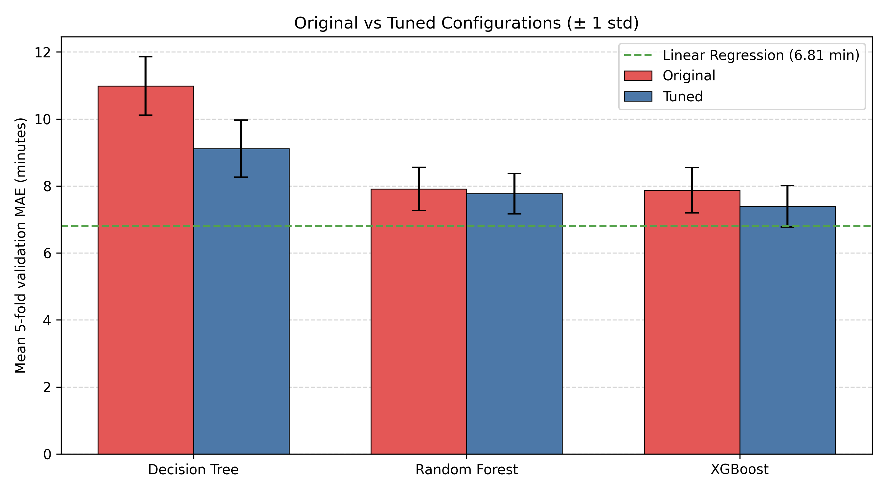
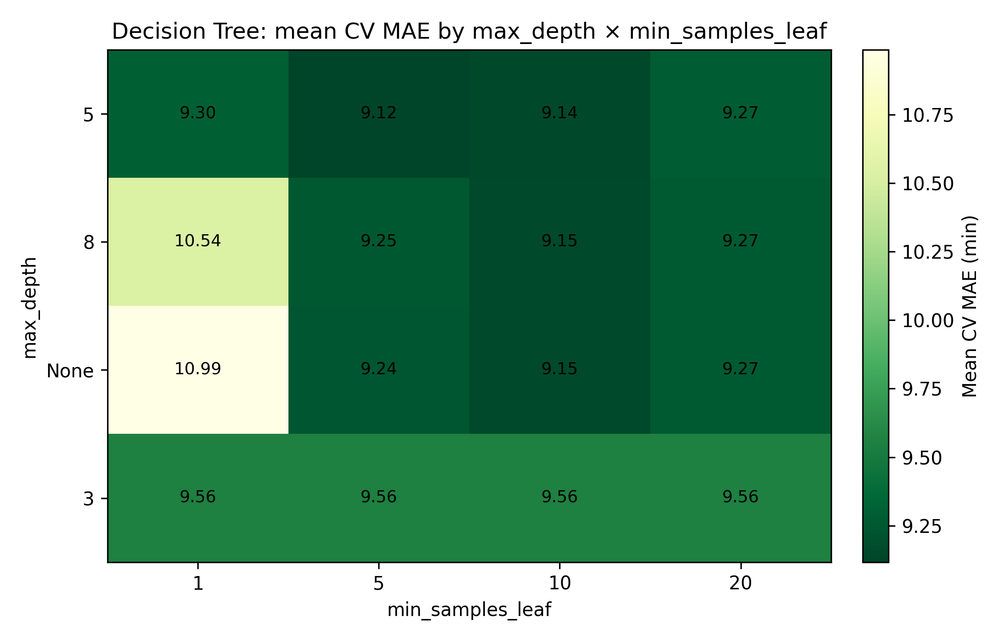
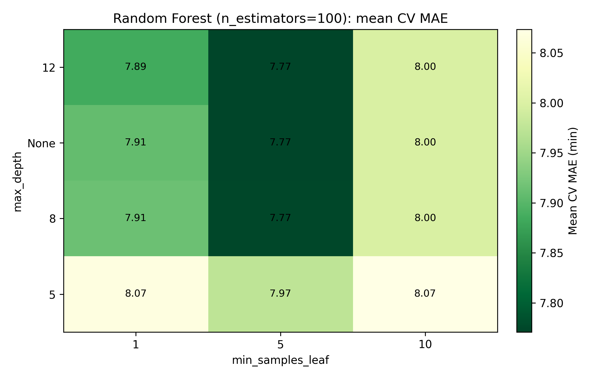
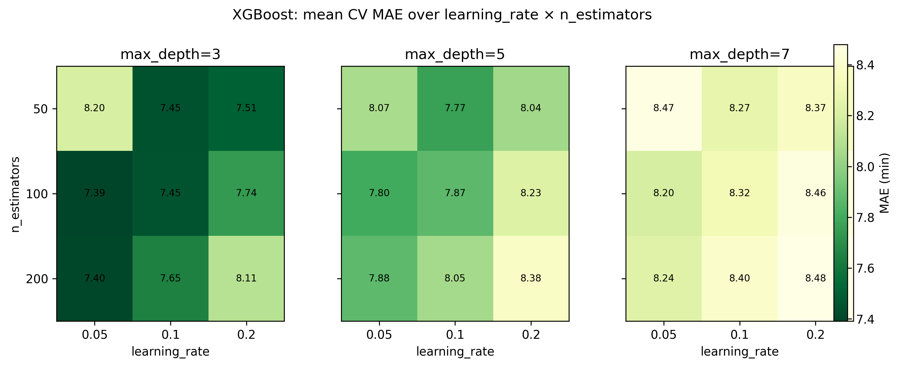

# Controlled Model Tuning Report

## The question

Can we improve Decision Tree, Random Forest, and XGBoost **systematically** — with a small, pre-declared search space and the same five training-set folds — rather than by one-at-a-time trial and error?

Previous work already showed *where* to look. The unrestricted Decision Tree memorized the training set (train MAE 0.00, validation MAE 10.99). The depth sweep in the learning-curve study peaked at `max_depth=5`. Random Forest and XGBoost overfit more mildly (train MAE ~3 minutes vs validation ~7.9). XGBoost had already been run at `max_depth=5`. This experiment turns those observations into a grid search.

**Short answer:** yes, within a limited range. Regularizing the trees cuts validation MAE for every model, with the largest gain on the Decision Tree (−1.87 min) and a clear gain on XGBoost (−0.48 min). Random Forest moves only −0.14 min. **None of the tuned trees overtake Linear Regression** (6.81 min CV MAE). Tuning mainly shrinks overfitting; it does not change the ranking of model families on this largely linear dataset.

---

## 1. What stayed fixed

| Item | Value |
|---|---|
| Dataset | `Food_Delivery_Times.csv` |
| Training rows | 800 (20% holdout never used for search) |
| Held-out test rows | 200, scored only after the grids finished |
| Splitter | `KFold(n_splits=5, shuffle=True, random_state=42)` — **identical folds** to Parts 1–4 |
| Features | Original columns only (engineered features did not help in Part 3) |
| Preprocessing | Median impute + scale numerics; most-frequent impute + one-hot categoricals, **fit inside each fold** |
| Metric | Validation MAE in minutes (lower is better) |
| Search method | `GridSearchCV`, exhaustive over a small grid |
| RF `n_estimators` | **Fixed at 100**, the value used in the original pipeline and the CV study |

The holdout set is reported as a check that the selected configs still help on unseen rows. It was **not** used to pick hyperparameters.

Script: `model_tuning.py`  
Tables: `output/tuning_comparison.csv`, `output/tuning_grid_decision_tree.csv`, `output/tuning_grid_random_forest.csv`, `output/tuning_grid_xgboost.csv`  
Plots: `plots/tuning_original_vs_tuned.png`, `plots/tuning_dt_heatmap.png`, `plots/tuning_rf_heatmap.png`, `plots/tuning_xgb_heatmaps.png`

---

## 2. Original configurations (the baselines)

These are the same settings as `cross_validation.py`.

| Model | Original settings | Mean CV MAE | Mean train MAE | Gap |
|---|---|---:|---:|---:|
| Decision Tree | `max_depth=None`, `min_samples_leaf=1` | 10.9863 | 0.0000 | 10.9863 |
| Random Forest | `n_estimators=100`, `max_depth=None`, `min_samples_leaf=1` | 7.9085 | 3.0611 | 4.8474 |
| XGBoost | `n_estimators=100`, `learning_rate=0.1`, `max_depth=5` | 7.8687 | 2.8107 | 5.0580 |
| Linear Regression | sklearn defaults (not tuned) | **6.8075** | 6.6437 | 0.1638 |

Linear Regression is an **untuned reference**, not a competitor in the grid. It is the number every tuned tree still has to beat.

---

## 3. Search spaces (kept small on purpose)

The grids only vary knobs that earlier experiments already implicated. That is the difference from trial and error: the space is declared first, every combination is scored on the same folds, and the winner is the lowest mean validation MAE.

### 3.1 Decision Tree — `max_depth` × `min_samples_leaf` (16 configs)

| Parameter | Values | Why these |
|---|---|---|
| `max_depth` | 3, 5, 8, `None` | Depth 3 underfit, 5 was the single-tree minimum, 8+ overfit, `None` is the original |
| `min_samples_leaf` | 1, 5, 10, 20 | `1` is the original (full memorization); larger leaves are the natural regularizer |

### 3.2 Random Forest — `max_depth` × `min_samples_leaf` (12 configs)

| Parameter | Values | Why these |
|---|---|---|
| `n_estimators` | **100 (fixed)** | Original pipeline and CV experiment; bagging already averages 100 trees |
| `max_depth` | 5, 8, 12, `None` | Shallower than a single unrestricted tree, including the original `None` |
| `min_samples_leaf` | 1, 5, 10 | Same leaf-size idea as the Decision Tree grid |

### 3.3 XGBoost — `learning_rate` × `n_estimators` × `max_depth` (27 configs)

| Parameter | Values | Why these |
|---|---|---|
| `max_depth` | 3, **5**, 7 | 5 is the original / previously studied depth; 3 and 7 sit on either side |
| `learning_rate` | 0.05, **0.1**, 0.2 | 0.1 is the original; slower vs faster shrinkage |
| `n_estimators` | 50, **100**, 200 | 100 is the original; half and double the boosting rounds |

55 configurations in total, each scored on five folds (preprocessing refit every time).

---

## 4. Selected models vs originals

| Model | Best tuned settings | Mean CV MAE | Δ vs original | Holdout MAE | Δ vs original holdout |
|---|---|---:|---:|---:|---:|
| Decision Tree | `max_depth=5`, `min_samples_leaf=5` | 9.1169 | **−1.8694** | 8.8370 | **−2.4530** |
| Random Forest | `max_depth=12`, `min_samples_leaf=5`, `n_estimators=100` | 7.7708 | **−0.1377** | 6.7540 | **−0.1291** |
| XGBoost | `learning_rate=0.05`, `max_depth=3`, `n_estimators=100` | 7.3910 | **−0.4777** | 6.6662 | **−0.3666** |
| Linear Regression | (untuned reference) | **6.8075** | — | **6.0634** | — |

All three tuned models also get a **smaller generalization gap** and a **slightly lower fold-to-fold std**.

| Model | Original gap | Tuned gap | Original CV std | Tuned CV std |
|---|---:|---:|---:|---:|
| Decision Tree | 10.9863 | 1.5415 | 0.8759 | 0.8524 |
| Random Forest | 4.8474 | 2.1079 | 0.6463 | 0.6011 |
| XGBoost | 5.0580 | 1.3022 | 0.6752 | 0.6199 |
| Linear Regression | 0.1638 | — | 0.4526 | — |

The search did what regularization is supposed to do: raise training error a little, lower validation error more. It did **not** close the remaining ~0.58 minutes between tuned XGBoost (7.39) and Linear Regression (6.81).



---

## 5. Decision Tree grid

The heatmap is a two-dimensional version of the earlier depth curve, now with leaf size as a second axis.



| Rank | `max_depth` | `min_samples_leaf` | Mean CV MAE | Mean train MAE |
|---:|---|---:|---:|---:|
| 1 | 5 | 5 | **9.1169** | 7.5753 |
| 2 | 5 | 10 | 9.1422 | 7.6795 |
| 3 | 8 / None | 10 | 9.1500 | 7.1505 |
| 10 | 5 | 1 | 9.3021 | 7.5041 |
| 11–14 | 3 | 1, 5, 10, 20 | 9.5554 | 9.1779 |
| 16 | None | 1 (original) | 10.9863 | 0.0000 |

**What the grid shows**

- Depth 5 remains the right height, matching the learning-curve minimum (9.30 min at `min_samples_leaf=1`). Requiring 5 samples per leaf shaves another ~0.19 min off that already-best depth.
- At `max_depth=3` every leaf-size setting is identical (9.5554). A stump this short never creates tiny leaves, so `min_samples_leaf` is unused.
- `max_depth=8` or `None` with `min_samples_leaf=1` still overfits (train MAE 3.40 and 0.00). Raising the leaf size to 5–20 pulls those deep trees back toward ~9.2 min — almost as good as a well-chosen shallow tree. Leaf size can substitute for an explicit depth cap.
- The original unrestricted tree is **last** in the 16-point grid. The default was the worst point in a space we already had reason to distrust.

The tuned tree is still **2.31 minutes worse** than Linear Regression. Axis-aligned splits remain a bad match for a mostly additive, continuous delivery-time process. Tuning fixes the *variance* of the tree; it does not give the tree a linear slope.

---

## 6. Random Forest grid

`n_estimators` stayed at 100. Only depth and leaf size moved.



| Rank | `max_depth` | `min_samples_leaf` | Mean CV MAE | Mean train MAE |
|---:|---|---:|---:|---:|
| 1 | 12 | 5 | **7.7708** | 5.6629 |
| 2 | None | 5 | 7.7709 | 5.6628 |
| 3 | 8 | 5 | 7.7743 | 5.6991 |
| 5 | None | 1 (original) | 7.9085 | 3.0611 |
| 12 | 5 | 10 | 8.0735 | 6.9515 |

**What the grid shows**

- The three best cells are almost the same (~7.77 min) and all use `min_samples_leaf=5`. Depth 8, 12, or unlimited barely matters once leaves cannot be size 1. Bagging plus a modest leaf constraint is doing the work.
- Depth 5 is **too** shallow for the forest (best depth-5 cell is 7.97). The ensemble wants slightly richer trees than the single Decision Tree, then averages them.
- The original unrestricted forest (`max_depth=None`, `min_samples_leaf=1`) sits mid-pack, not worst, but it overfits more (train MAE 3.06 vs 5.66 for the winner).
- The gain versus original is only **0.14 minutes**. Random Forest was already an averaged, somewhat regularized model. There is little left for a 12-point grid to find.

---

## 7. XGBoost grid

Depth was the knob already studied (`max_depth=5`). This grid adds shrinkage and boosting rounds around that choice.



**Best 6 of 27** (all of them are `max_depth=3`):

| Rank | `learning_rate` | `n_estimators` | `max_depth` | Mean CV MAE | Mean train MAE |
|---:|---:|---:|---:|---:|---:|
| 1 | 0.05 | 100 | 3 | **7.3910** | 6.0888 |
| 2 | 0.05 | 200 | 3 | 7.3993 | 5.4007 |
| 3 | 0.10 | 50 | 3 | 7.4456 | 6.0909 |
| 4 | 0.10 | 100 | 3 | 7.4486 | 5.4251 |
| 5 | 0.20 | 50 | 3 | 7.5056 | 5.4063 |
| 10 | 0.10 | 100 | 5 (original) | 7.8687 | 2.8107 |
| 27 | 0.20 | 200 | 7 | 8.4800 | 0.0213 |

**What the grid shows**

- The search **rejects the previously used depth**. Every top configuration is `max_depth=3`. Deeper trees (5 and 7) drive training MAE toward zero and *raise* validation error.
- Slow learning plus a moderate number of trees beats fast learning plus many trees. `(lr=0.05, n=100)` and `(lr=0.05, n=200)` are essentially tied; `(lr=0.2, n=200, depth=7)` is the worst cell and has essentially memorized the training folds (train MAE 0.02).
- `n_estimators=100` remains a reasonable budget: the winner keeps 100 rounds and only changes rate and depth. Doubling the rounds at `lr=0.05`, depth 3, does not help.
- Original XGBoost ranks **10th of 27**. The default was not catastrophic, but it was clearly too deep and too aggressive for 800 rows.

The tuned booster is the best tree model in this project (7.39 min), yet still **0.58 min behind Linear Regression**, and its remaining gap (1.30 min) is still larger than Linear Regression’s (0.16 min).

---

## 8. Per-fold check

Same five folds as Part 1. Lower is better.

| Fold | DT original | DT tuned | RF original | RF tuned | XGB original | XGB tuned |
|---:|---:|---:|---:|---:|---:|---:|
| 1 | 11.4812 | 9.4454 | 7.4231 | 7.3573 | 7.2218 | 6.9900 |
| 2 | 11.5000 | 8.4132 | 7.7222 | 7.3477 | 7.3424 | 6.9224 |
| 3 | 11.7937 | 10.3770 | 8.4769 | 8.5788 | 8.5846 | 8.0004 |
| 4 | 10.4375 | 9.0768 | 8.6924 | 8.2552 | 8.6027 | 8.1342 |
| 5 | 9.7188 | 8.2719 | 7.2281 | 7.3151 | 7.5918 | 6.9082 |

Decision Tree and XGBoost improve on **every** fold. Random Forest improves on four folds and is slightly worse on fold 3 (8.48 → 8.58) — consistent with a small, noisy gain rather than a new structural fit.

---

## 9. Direct answers

### Can we improve the models systematically rather than by trial and error?

Yes. A pre-declared grid, shared folds, and a single metric produced settings that beat the originals for all three models, and the heatmaps show *why* those settings won (shallower / larger leaves / slower boosting). That is stronger evidence than a handful of ad-hoc reruns.

### What actually improved?

| Effect | Decision Tree | Random Forest | XGBoost |
|---|---|---|---|
| Validation MAE | Large (−1.87 min) | Small (−0.14 min) | Moderate (−0.48 min) |
| Overfitting | Collapsed (gap 11.0 → 1.5) | Halved (4.8 → 2.1) | Collapsed (5.1 → 1.3) |
| Holdout | Confirms the CV gain | Confirms a small gain | Confirms the CV gain |

The direction of every change is **regularization**: stop growing, require bigger leaves, shrink updates, or use shallower boosters.

### Did tuning change which model we should deploy?

No. Linear Regression remains best on mean CV MAE, fold stability, and holdout. Tuning made the tree family more honest; it did not make them linear.

A fair reading of the five parts together:

1. Linear Regression’s win is not a lucky split.
2. Unrestricted trees overfit; shallow trees underfit.
3. Hand-built interactions do not help the linear model.
4. Residual error is concentrated on long, high-traffic, bad-weather trips.
5. **Systematic regularization helps trees, but not enough to overtake the linear baseline.**

---

## 10. How to reproduce

```bash
python model_tuning.py
```

Requires `pandas`, `scikit-learn`, `xgboost`, and `matplotlib`. The script writes the CSVs under `output/` and the four figures under `plots/`.
