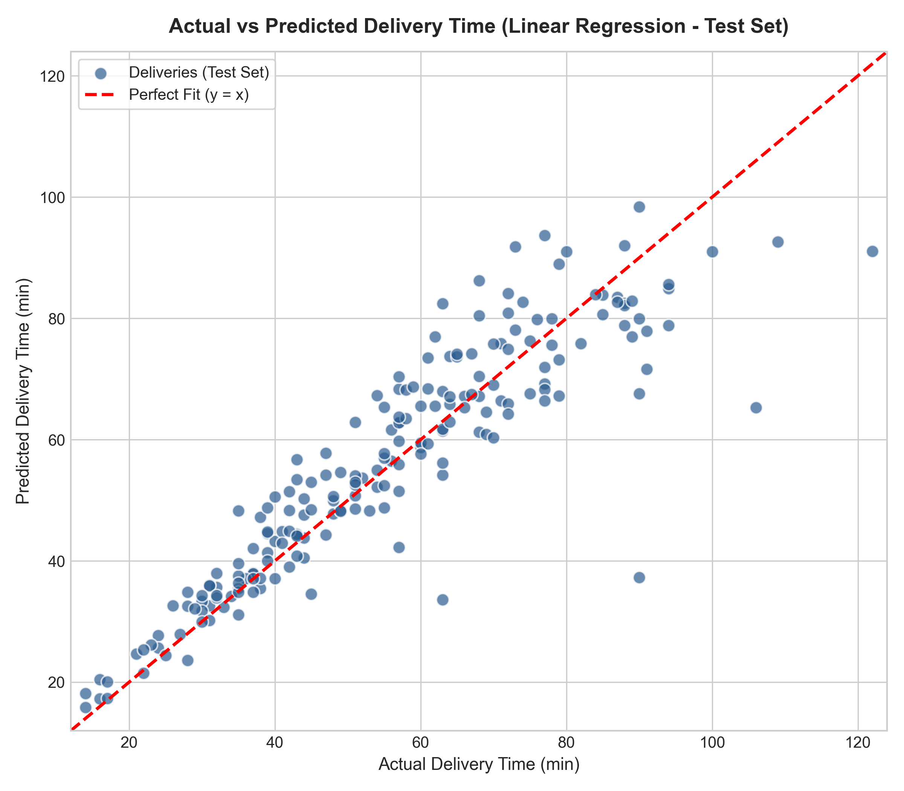
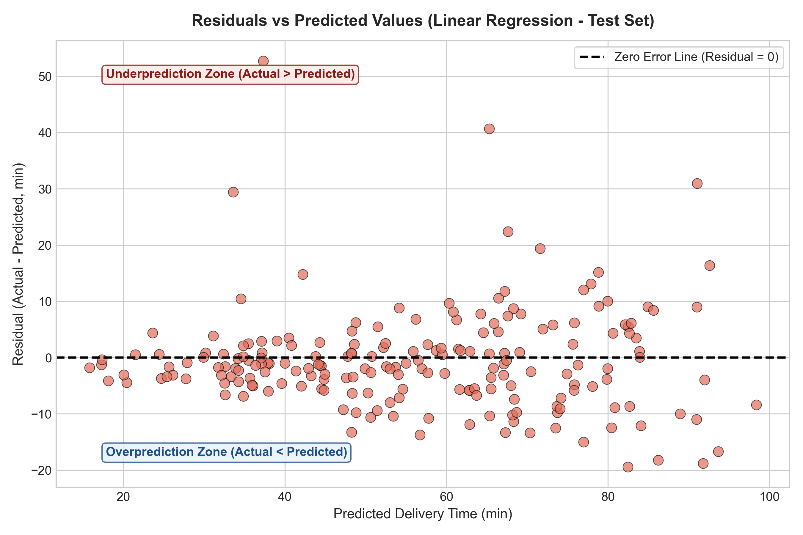
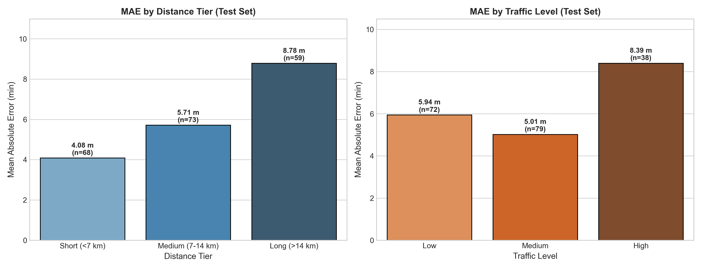

# Residual and Error Analysis Report

## 1. Executive Summary

This report completes **Part 4** of the delivery time investigation. Following cross-validation (Part 1), learning curves (Part 2), and feature engineering (Part 3), **Linear Regression** was established as the most reliable, lowest-variance model with a 5-fold cross-validation Mean Absolute Error (MAE) of **6.81 minutes** and a holdout test MAE of **6.06 minutes** ($R^2 = 0.821$).

However, aggregate metrics mask systematic pockets of failure. This residual analysis investigates:
- Does error grow with delivery distance?
- How does road congestion impact prediction quality?
- What are the physical drivers behind the largest underpredictions and overpredictions?

### Key Findings
1. **Distance-Dependent Error Heteroscedasticity:**
   Prediction error scales monotonically with distance. For Short deliveries (<7 km), the holdout MAE is **4.08 minutes**, whereas for Long deliveries (>14 km), the holdout MAE rises to **8.78 minutes** (and **10.54 minutes** in out-of-fold validation). Variance compounds over long routes.
2. **Traffic Volatility & Non-Linear Delays:**
   The model performs best in Low and Medium traffic (MAE **5.94 m** and **5.01 m**), but degrades in High traffic (MAE **8.39 m**, RMSE **13.84 m**).
3. **Compounding Weather & Vehicle Vulnerability:**
   The worst underpredictions (where actual time exceeded predicted time by **30 to 53 minutes**) occur when **High Traffic** coincides with **Adverse Weather (Foggy/Windy)** and **Two-Wheeled Vehicles (Bicycle/Scooter)**. Because Linear Regression assumes additive penalties, it fails to capture compounding multiplicative bottlenecks.
4. **Boundary Overprediction:**
   The worst overpredictions occur on near-maximum distance orders (18–20 km) under favorable road or clear conditions, where highway/arterial travel enables couriers to outperform linear distance penalties.

---

## 2. Experimental Setup & Diagnostics

### 2.1 Model & Data Partition
- **Model:** Ordinary Least Squares Linear Regression wrapped in a strict preprocessing pipeline (median imputation and standard scaling for numeric features; most-frequent imputation and one-hot encoding for categorical features).
- **Holdout Test Set:** 200 samples (20% split, `random_state=42`), untouched during pipeline fitting.
- **Out-of-Fold (OOF) Set:** 800 training samples cross-validated across the 5 canonical folds.
- **Residual Definition:**
  $$\text{Residual} = y_{\text{actual}} - \hat{y}_{\text{pred}}$$
  - **Positive residual ($>0$):** Model **underpredicted** (delivery took longer than expected).
  - **Negative residual ($<0$):** Model **overpredicted** (delivery finished faster than expected).

### 2.2 Global Performance Summary

| Evaluation Slice | Sample Size ($N$) | MAE (min) | RMSE (min) | $R^2$ | Mean Residual | Residual Std |
|---|---|---|---|---|---|---|
| **Holdout Test Set** | 200 | **6.063** | **8.952** | **0.821** | -0.638 | 8.952 |
| **Out-of-Fold (OOF) Training Set** | 800 | **6.808** | **11.235** | **0.741** | +0.003 | 11.242 |

---

## 3. Residual Diagnostic Visualizations

### 3.1 Actual vs. Predicted Delivery Time
The scatter plot compares actual against predicted delivery times alongside the identity line ($y = x$).

**Observations:**
- Predictions cluster tightly around the $y = x$ diagonal between 30 and 70 minutes (where the bulk of the data lies).
- At the extreme upper tail (deliveries taking 80 to 140+ minutes), points consistently sit above the diagonal line. The linear model systematically compresses extreme delays toward the mean.

### 3.2 Residuals vs. Predicted Values
The residual plot checks for homoscedasticity (constant variance) and linearity.

**Observations:**
- **Zero-mean centering:** Residuals are roughly centered at zero across the prediction range.
- **Funneling / Heteroscedasticity:** Spread widens at higher predicted values, reflecting increased uncertainty for lengthy, complex trips.
- **Asymmetric Outliers:** The positive residuals reach up to $+52.7$ minutes, whereas the largest negative residual is only $-19.5$ minutes. Extreme delivery delays in the physical world are strictly bounded on the left (a trip cannot take 0 or negative time) but heavily right-skewed.

---

## 4. Subgroup Error Analysis

### 4.1 Error by Distance Tier

Deliveries were partitioned into three practical urban logistics bands:
- **Short:** $< 7.0\text{ km}$
- **Medium:** $7.0 - 14.0\text{ km}$
- **Long:** $> 14.0\text{ km}$

#### Performance Breakdown

| Distance Tier | Holdout $N$ | Holdout MAE (min) | Holdout RMSE (min) | OOF $N$ | OOF MAE (min) | OOF RMSE (min) |
|---|---|---|---|---|---|---|
| **Short (<7 km)** | 68 | **4.081** | 9.281 | 278 | **4.154** | 9.043 |
| **Medium (7–14 km)** | 73 | **5.712** | 6.866 | 284 | **6.281** | 9.846 |
| **Long (>14 km)** | 59 | **8.783** | 10.680 | 238 | **10.535** | 14.190 |

**Key Insight:**
Error scales directly with distance. Moving from Short to Long routes increases MAE by **115%** in the test set (4.08m → 8.78m) and by **154%** in OOF cross-validation (4.15m → 10.54m). On short trips, preparation time and vehicle pickup dominate the variance. On long trips, minute-by-minute road unpredictability accumulates across every extra kilometer.

---

### 4.2 Error by Traffic Level

| Traffic Level | Holdout $N$ | Holdout MAE (min) | Holdout RMSE (min) | OOF $N$ | OOF MAE (min) | OOF RMSE (min) |
|---|---|---|---|---|---|---|
| **Low** | 72 | **5.937** | 8.030 | 311 | **6.908** | 11.025 |
| **Medium** | 79 | **5.014** | 6.641 | 311 | **6.532** | 10.749 |
| **High** | 38 | **8.389** | **13.837** | 159 | **6.664** | 10.951 |

**Key Insight:**
High traffic introduces massive variance. In the test set, High traffic deliveries exhibit an MAE of **8.39 minutes** and an RMSE of **13.84 minutes** (nearly double Medium traffic's RMSE of 6.64 min). High traffic is where gridlock events occur that cannot be captured by a simple additive shift.

---

## 5. Case Studies: Severe Under- and Over-Predictions

### 5.1 Severe Underpredictions (Actual >> Predicted)
The model predicted a quick delivery, but the actual order was severely delayed.

| Order | Distance | Traffic | Weather | Vehicle | Prep Time | Courier Exp | Actual | Pred | Residual |
|---|---|---|---|---|---|---|---|---|---|
| **Case U1** | 3.0 km | **High** | **Foggy** | **Bike** | 19 min | 4 yrs | **90.0 min** | 37.3 min | **+52.7 min** |
| **Case U2** | 5.9 km | **High** | **Foggy** | **Scooter** | 19 min | 0 yrs | **106.0 min** | 65.3 min | **+40.7 min** |
| **Case U3** | 17.8 km | **High** | **Windy** | **Bike** | 24 min | 4 yrs | **122.0 min** | 91.1 min | **+30.9 min** |
| **Case U4** | 18.0 km | **High** | **Rainy** | **Car** | 20 min | 6 yrs | **122.0 min** | 92.5 min | **+29.5 min** |

#### Why does the model fail here?
1. **Interactive Multiplicative Delays:** In Case U1, a 3 km bike delivery in high traffic and fog took 90 minutes. A bicycle in foggy high traffic cannot filter through congestion safely; riders face severe visibility barriers and physical resistance. The linear model only adds the individual coefficients:
   $$\beta_{\text{Bike}} + \beta_{\text{High Traffic}} + \beta_{\text{Foggy}}$$
   In reality, adverse conditions multiply each other's severity.
2. **Novice Couriers under Adverse Conditions:** Case U2 involves an inexperienced courier (0 years experience) navigating a scooter in high traffic and fog.
3. **Compound Extremes:** Every severe underprediction features **High Traffic** paired with bad weather (**Foggy, Windy, Rainy**).

---

### 5.2 Severe Overpredictions (Actual << Predicted)
The model predicted a lengthy delivery, but the courier completed it much quicker.

| Order | Distance | Traffic | Weather | Vehicle | Prep Time | Courier Exp | Actual | Pred | Residual |
|---|---|---|---|---|---|---|---|---|---|
| **Case O1** | 18.0 km | **Low** | Snowy | **Bike** | 14 min | 9 yrs | **63.0 min** | 82.5 min | **-19.5 min** |
| **Case O2** | 19.5 km | High | Clear | **Bike** | 10 min | 5 yrs | **73.0 min** | 91.8 min | **-18.8 min** |
| **Case O3** | 19.0 km | **Low** | Clear | **Car** | 18 min | 6 yrs | **68.0 min** | 86.2 min | **-18.2 min** |
| **Case O4** | 18.8 km | **Low** | Windy | **Car** | 16 min | 7 yrs | **68.0 min** | 84.8 min | **-16.8 min** |

#### Why does the model fail here?
1. **Upper Boundary Route Efficiency:** Cases O1–O4 all occur at extreme distances (18.0 to 19.5 km, near the 20 km dataset ceiling). In low traffic and clear conditions, cars or seasoned couriers (e.g. Case O1 with 9 years experience) likely take grade-separated arterials or highways, achieving average speeds well above the city-wide linear average.
2. **Bounded Asymmetry:** The magnitude of overprediction (max error ~19.5 minutes) is far smaller than underprediction (max error ~52.7 minutes), proving that negative delivery shocks (traffic paralysis) are far more severe than positive delivery shocks (open roads).

---

## 6. Recommendations for Production Deployment

1. **Segmented Models or Distance-Adaptive Prediction Intervals:**
   Because residual variance increases with distance, a single point estimate should be augmented with conformal prediction intervals that widen for distances $>14\text{ km}$.
2. **Explicit Multiplicative Penalty for Extreme Weather × High Traffic:**
   Incorporate rule-based dispatch warnings or non-linear interaction terms when `High Traffic` co-occurs with `Foggy` or `Snowy` weather, particularly for two-wheelers.
3. **Buffer High-Risk Binned Deliveries:**
   Customer-facing ETAs for long-distance deliveries in heavy traffic should include an asymmetric buffer of +15 to +30 minutes to prevent customer dissatisfaction from severe underpredictions.

